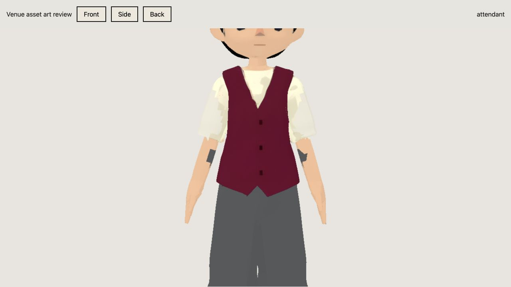
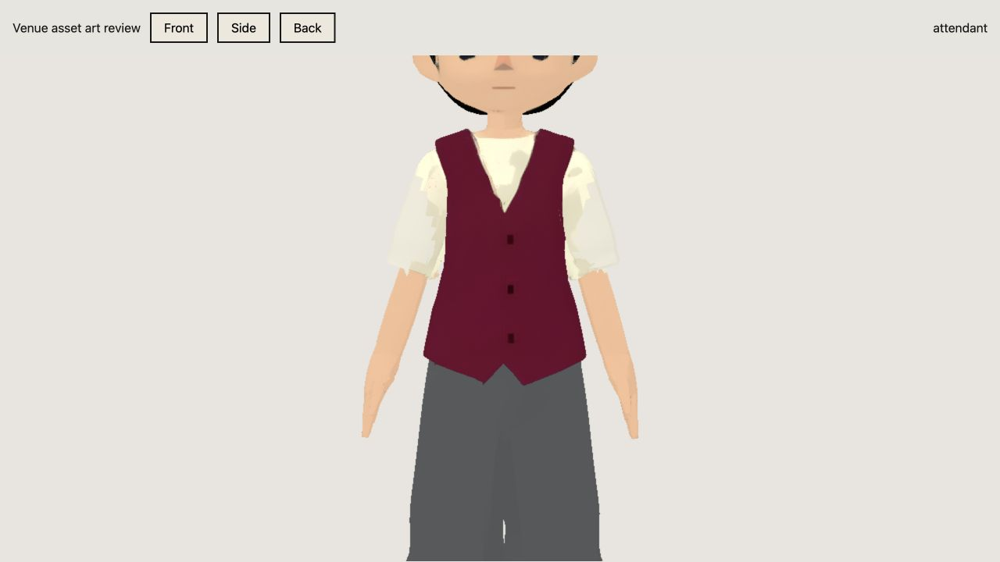
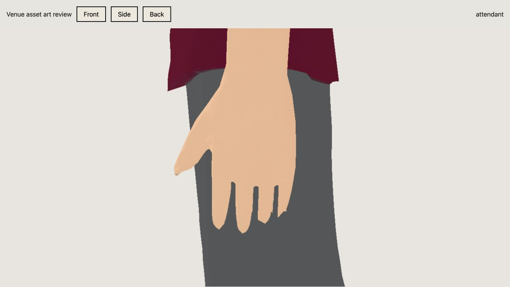
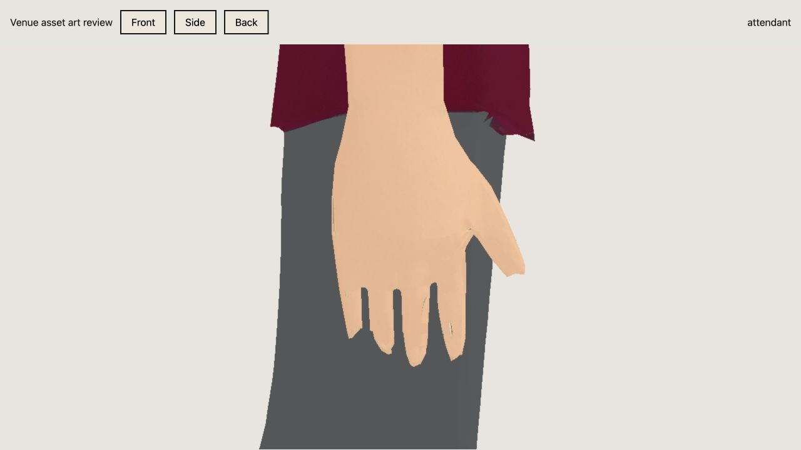
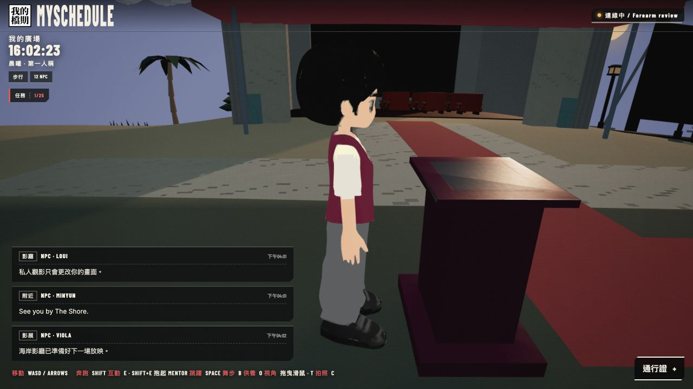
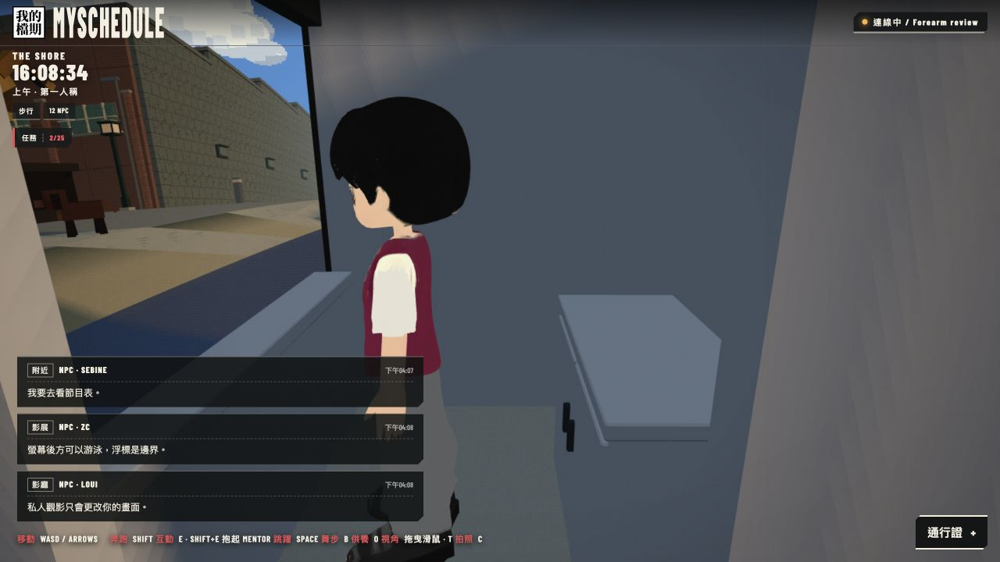

# Attendant forearm and hand review — 2026-10-11

Both the Palace inspector and Drive-In 88 clerk use the repaired attendant GLB.

The clothing material repair had incorrectly classified 47 inner-arm faces as trousers. Restoring their authored skin material removes the dark patches; the repair script now excludes faces owned by arm/hand bones from the trouser selection.

The generated ring/little fingers were connected, and the left hand contained 14 boundary edges. Live Blender MCP inspection and repair closed those source openings and cut three rounded gaps in each hand. The authored thumb, palm and wrist remain; each hand has four separated fingers and one thumb. New inner surfaces sample a clean authored skin texel. Hand-only triangulation and seam welding keep the exported cut surfaces closed. The Boolean collapsed one pre-existing duplicate coplanar body triangle; outside-hand surface positions remain unchanged.

Installed asset: `2248d11158447b6bd21866329c2ae157a760fe604a6acced046d1918032b9e1d`; 8,647,100 bytes, 19,115 triangles, 24 original bones. All four embedded image maps match the previous asset byte-for-byte. Existing rig/idle animation remain; this attendant rig has no individual finger bones.

Validation: 407/407 tests passed and TypeScript/Vite production build passed. Actual exported-geometry checks cover finger gaps, all four fingers, thumb presence and closed hand edges on both sides. Material checks reject trousers on arm-owned faces. Both Pages packages match dist and all 36 integrity hashes (18 per channel) passed.

Browser close-ups use the exported GLB and runtime materials. Forearm before/after and side views confirmed the material fix. The built-world Palace and booth images below were captured after the forearm repair, before the subsequent finger addition. Left/right hand close-ups show the final finger repair.

Built local site: http://127.0.0.1:4173/?era=ps2&island

Release continues in PR #17 on `codex/sign-backing-breaking-wheel`. GitHub requires macakinTT approval of the last push; this package is not live until reviewed and merged. No server change or Render redeploy is required.
