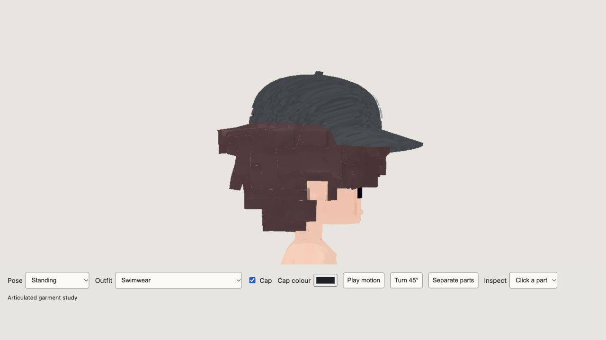
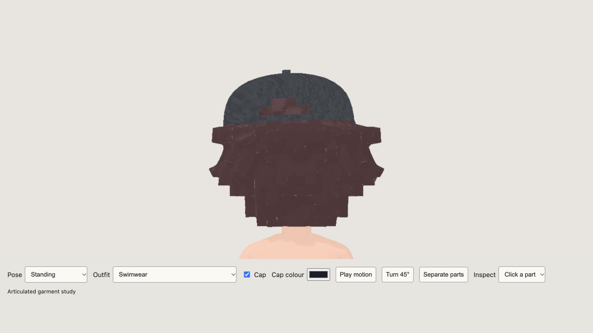
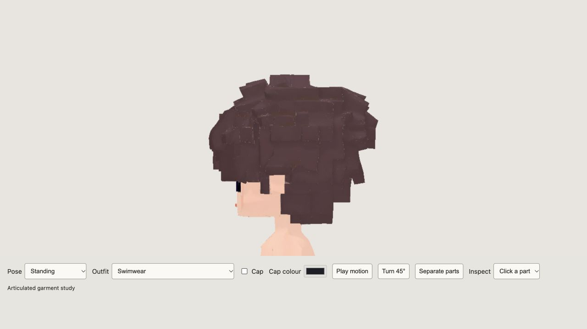

# Male cap and hair fit, 2026-10-12

Local built repair; owner visual acceptance is pending. No staging, commit, release packaging, publication or server change was performed.

The cap's old nearest-surface hair displacement had been transferred from the previous male body. It left curls outside the current cap crown and also moved a few non-hair vertices. Through live Blender MCP, the `CapHair` shape was reset and fitted against the actual current cap surface. Only hair under the cap changes when it is worn. The normal hairstyle, face, hands, feet and body remain at their original positions when the cap is removed. The adjustable rear opening remains open, so hair can still be seen through that opening.

Export preservation verifies all 14 mesh components' base position/normal/UV/weight/mask signatures, all 12 embedded image hashes and all 64 joint bind transforms against the pre-repair GLB. Only the cap-on body morph and its metadata changed. Female GLB hash is unchanged. Details: [preservation.json](preservation.json).

Current male GLB: **13,416,900 bytes**, SHA256 `ab3c969f23e2c28e2d6b38b409d3cc572afb47cd484da57bcf50efe6bfcb5278`.

**421/421 full tests pass**, TypeScript/Vite build passes, whitespace check passes. Two new regressions measure actual exported hair against the rendered cap in the current head frame and verify cap removal across outfits 1–3/swimwear without moving non-hair anatomy. The preceding installed asset fails both checks. Existing wardrobe, hand/foot and tracking regressions still pass. Physical camera or headset behavior was not exercised for this cap fit.

Browser close-ups of the built preview cover both sides, the rear, cap removal and the utility vest. [Local review](http://127.0.0.1:4173/avatar-review.html?sex=male&pose=idle&angle=0.6&outfit=3&cap=%23232a36&face).

Recovery source: `.artifacts/male-cap-fit-20261012/cap-fitted.blend`. Pre-repair snapshots: `before.blend` and `male-before.glb` in the same directory. Reusable cap-only fitting pass: `fit-cap-hair.py`, executed through live Blender MCP on the regenerated male scene. It writes `CapHair` from `Basis`, not from the previous morph, so it can be rerun without accumulating changes. Reset its value to zero before export. Working source remains `.artifacts/male-regeneration-20261012/male-regenerated.blend`; export with `export-candidate.py` then `compress.mjs` for lossless floating-point meshopt.

Logs: `.artifacts/male-cap-fit-20261012/full-tests.txt`, `cap-tests.txt`, `negative-tests.txt`, `build.txt`. The preceding outfit report is historical; this report supersedes its installed hash while preserving those garment repairs.
