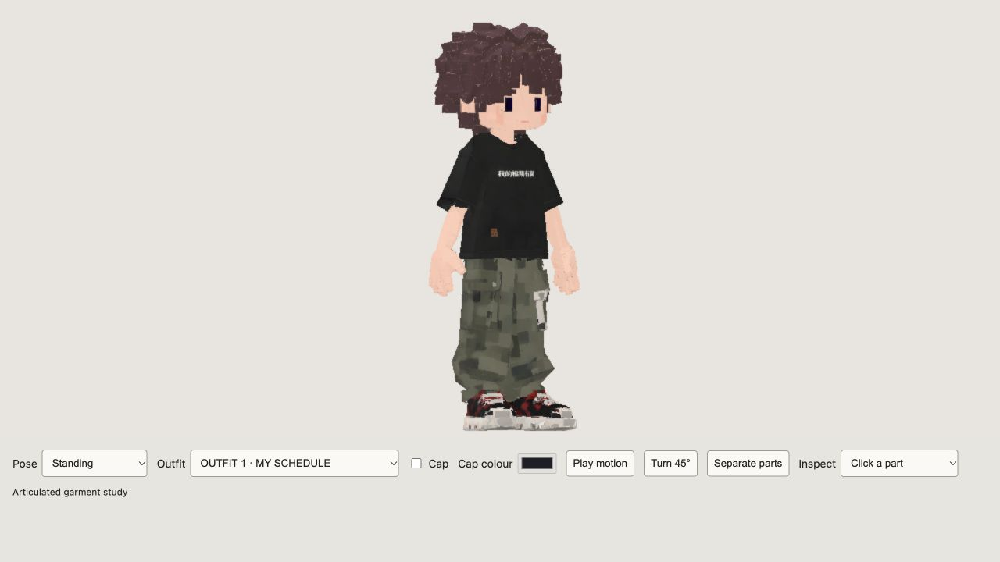
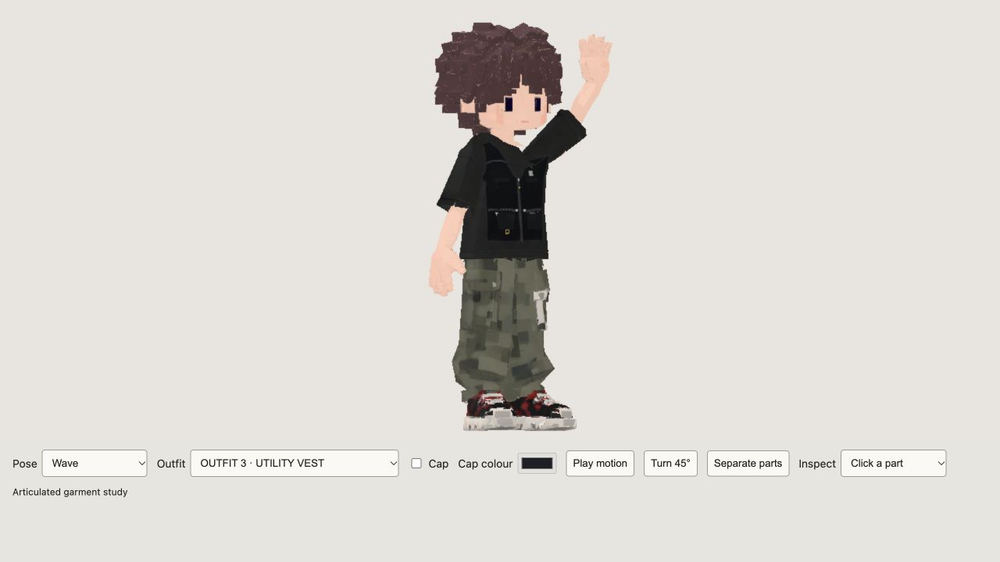

# Male outfits 1–3, 2026-10-12

Historical wardrobe evidence. The later [cap/hair follow-up](../male-cap-fit-20261012/REVIEW.md) supersedes this candidate's installed hash; these garment repairs remain in the current build.

Local build refreshed for owner review. No commit, staging, release package update or publication was performed.

The screenshot's jagged waistband came from fitting the trousers through different limb frames, while nearest-body weight transfer attached parts of the shirt, vest and prints to the thighs or head. Raising an arm also twisted the sleeve around the forearm and exposed isolated torso skin through the underarm.

Live Blender MCP refitted the original garment panels continuously around the regenerated body. The waistband now follows the pelvis, the shirt hem overlaps it at the front/sides/back, and torso garments and artwork follow the spine. Sleeves now fit and follow the anatomical upper arm without inherited forearm roll. The neck mask and enclosed torso-side mask were repaired. The original garment designs remain.

The regenerated body's positions, normals, UVs, weights and swim mask match the preceding installed candidate after accounting for meshopt vertex reordering. Shoes and cap surface signatures, all 12 embedded image hashes and all 64 joint bind transforms also match. Female GLB hash is unchanged. Detailed hashes are in [preservation.json](preservation.json).

Installed male GLB: 13,697,496 bytes; SHA256 `27637bb8c97eb30d12b72988d7c8d5dfa48b48237cb7e0c941a32d01e9b60ebe`.

Validation: **419/419 full tests pass**, TypeScript/Vite build passes. Four new regressions cover clothing bone ownership, the actual shirt/waistband clearance in all three outfits, waistband attachment through 16 walking phases, and covered torso-side skin. The pre-repair GLB fails the first three regressions. Browser screenshots use the actual built preview on port 4173: front/back for all three outfits, outfit 2 and 3 raised arm, and outfit 3 walking with the cap. These checks do not establish physical webcam/controller behavior or owner acceptance.

Review: [Outfit 1](http://127.0.0.1:4173/avatar-review.html?sex=male&pose=idle&angle=0.6&outfit=1&zoom=1.2), [Outfit 2](http://127.0.0.1:4173/avatar-review.html?sex=male&pose=idle&angle=0.6&outfit=2&zoom=1.2), [Outfit 3](http://127.0.0.1:4173/avatar-review.html?sex=male&pose=idle&angle=0.6&outfit=3&zoom=1.2).

Recovery source: `.artifacts/male-outfits-20261012/male-outfits-fixed.blend`, a saved copy of the final live Blender scene. The pre-repair GLB is `male-before.glb` in the same directory. `.artifacts/male-regeneration-20261012/male-regenerated.blend` is the current working source; export with that directory's `export-candidate.py`, which explicitly selects all 15 parts, then `compress.mjs` for lossless floating-point meshopt. Do not rerun `refit.py` alone: it records only the first fitting pass, while the final sleeve/hem/mask refinements are saved in the final Blender source. Do not run the old procedural male anatomy repair over this generated body.

Logs: `.artifacts/male-outfits-20261012/full-tests-final.txt`, `build.txt`, `negative-tests.txt`. Earlier regeneration report remains historical; this report supersedes its installed asset hash and outfit-fit validation.
