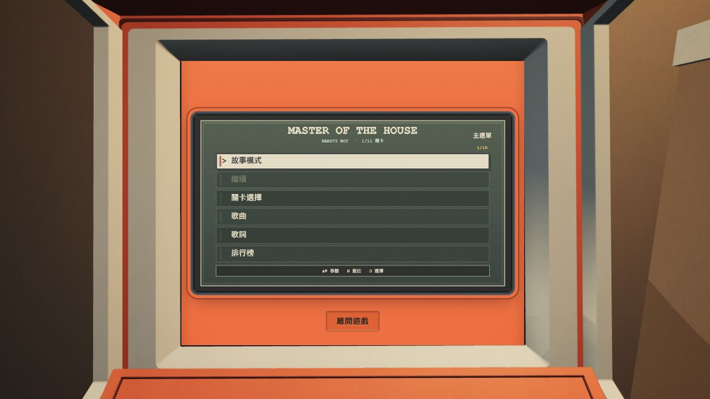
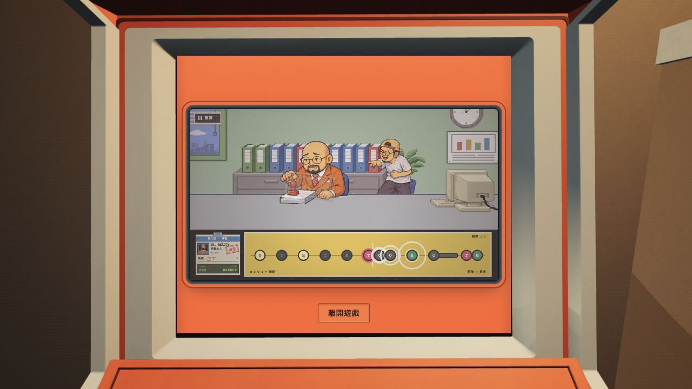
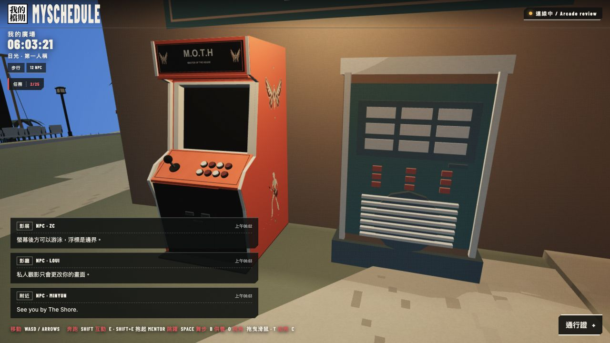
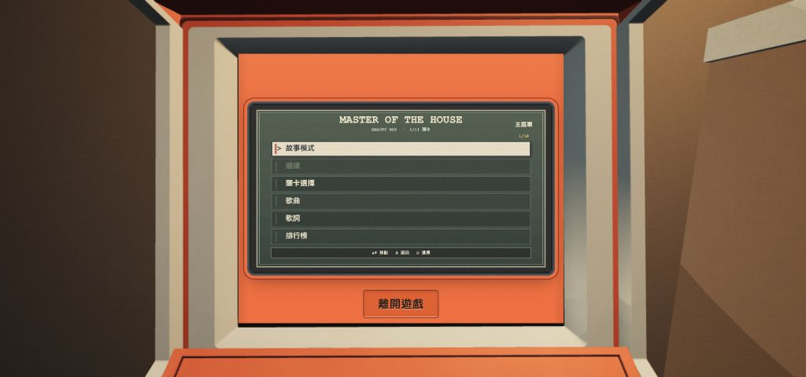
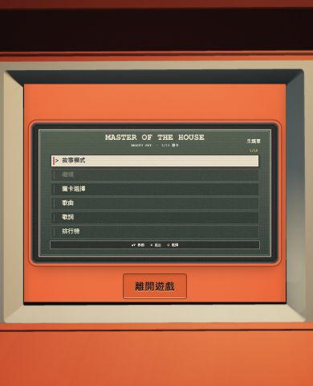

# M.O.T.H cabinet integration repair — 2026-10-14

Local only. The user requested an integrated single exit button, the cabinet back against the wall, and working game controls.

## Result

- Only **離開遊戲** remains, recessed into the lower orange game interface. Placement follows the projected cabinet screen, so it stays centred as the window changes. The fixed camera stays aligned with the physical screen.
- The cabinet root moved from X=21 to **X=20.52**. Its loaded back is X=21.576704, outside the actual wall surface X=21.6, leaving **2.33 cm** clearance. Its collider and rendered-ground seating follow this position; the combined arcade/jukebox footprint stays centred beneath the sign.
- The iframe now regains keyboard focus on load and its ready handshake. If clicking the cabinet surround sends the next key to the world, a source/origin-checked bridge delivers that key once to the game's existing private handlers. Native in-frame keys remain normal. Hidden/exit sessions release held keys.
- Exit click, Esc and native Tab then Space return to the world, and nearby E re-enters. The Space release preserves button activation and focus.

## Verification

**30/30 targeted tests passed**, including the actual GLB against the production rooftop wall, collider coverage, ground refitting, real game input handlers and bridge integrity. **TypeScript/Vite build passed**; the existing Three.js chunk-size warning remains.

Native local browser review verified loss-of-focus recovery, menu/stage navigation and active office rhythm gameplay scoring **006000** with character/note reactions. The timing audit found no game-clock defect; earlier all-miss QA runs were caused by tool/model gaps longer than the song.

At 1280×720, 1024×480 and 390×480 the button is centred within the orange band and clear of the game canvas. Temporary viewport overrides were reset. The final rebuilt browser also passed native Tab → Space Exit → E re-entry with no console errors. These are desktop browser checks, not physical phone/headset validation.

The optional whole M.O.T.H package checker could not run because this checkout lacks `.qa/moth/published-snapshot.json`. The targeted arcade suite verifies its bridge mirror, cache version/SRI and trusted input routing separately. No package or deployment success is inferred from this missing fixture.

Cabinet, male and female GLB hashes remain unchanged during this repair. `validation.json` records measurements, checks and preservation hashes. Test/build logs are in `.artifacts/moth-arcade-integration-20261014/`.

## Local review

http://127.0.0.1:4173/?era=ps2&island&review=arcade&cycleMinute=15

The review tab is left open on the live cabinet screen.

