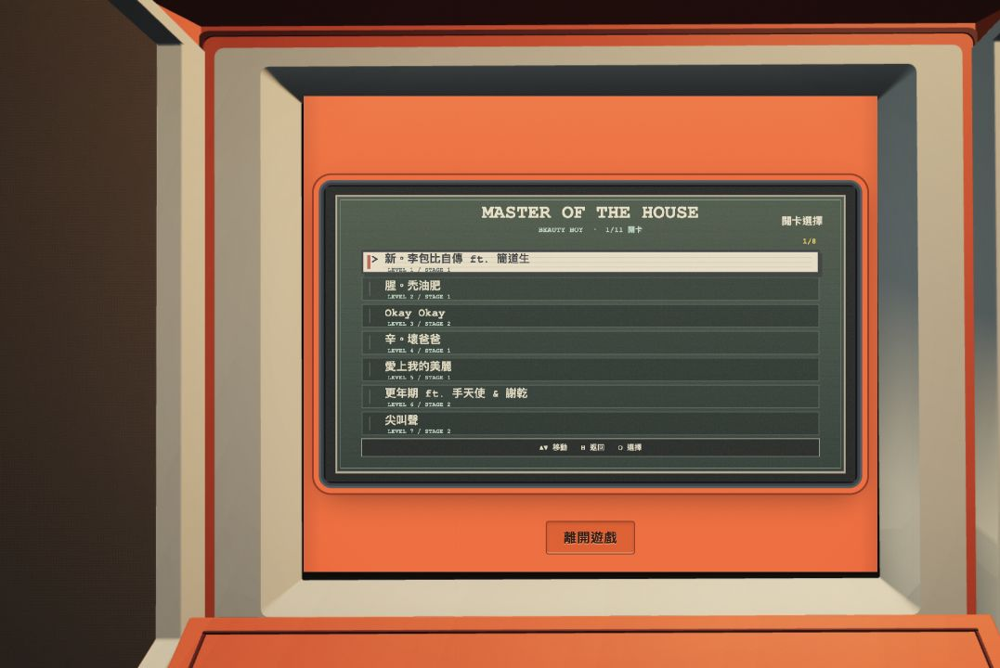

# Cabinet uses the live M.O.T.H release — 2026-10-14

The cabinet previously selected the checked-in public game snapshot when the world ran on loopback. It now always loads `https://myscheduleltd.com/moth/`, including local previews. Each desktop cabinet entry adds `arcade=1` and a new UUID `arcadeLaunch` query value to fetch a fresh entry page. Mobile/immersive VR opens the same public route with a fresh launch value and without the embedded flag.

The live entry supplies its current versioned scripts/styles. This does not pin or copy a game build into the festival; ordinary static resources remain under the public site's own cache/version policy. Website deployment/CDN availability still determines what the public URL serves.

The stale local preview middleware and test/import were removed. Surround pointer clicks refocus the live iframe before the next native key, without relying on a child bridge. Exit remains accessible by click or native Tab then Space. The game's own in-frame keyboard controls remain native; cabinet-specific message handling is available only if the public game opts into the bridge. The current live game does not expose that adapter, so in-frame Esc follows M.O.T.H's own controls; use the visible 離開遊戲 button to leave the cabinet.

Native browser verification read `./src/game.js?v=moth-loading-20261014b` initially. During the inspection the public game advanced, and the final new entry loaded `./src/game.js?v=moth-loading-20261014d` without rebuilding/copying a game snapshot. Native Down/Down/O opened stage selection; surround focus restoration, Exit click, native Tab/Space Exit and E re-entry passed. Entry URLs differ on each launch. No console errors captured.

The full cleanup verification ran **453/453 tests** and the TypeScript/Vite build. Evidence: `browser-verification.json`, `live-controls.png`, `live-game.png`, and `../cleanup-20261014/validation.json`.

Local only. No BETA/PS2 deployment performed.

